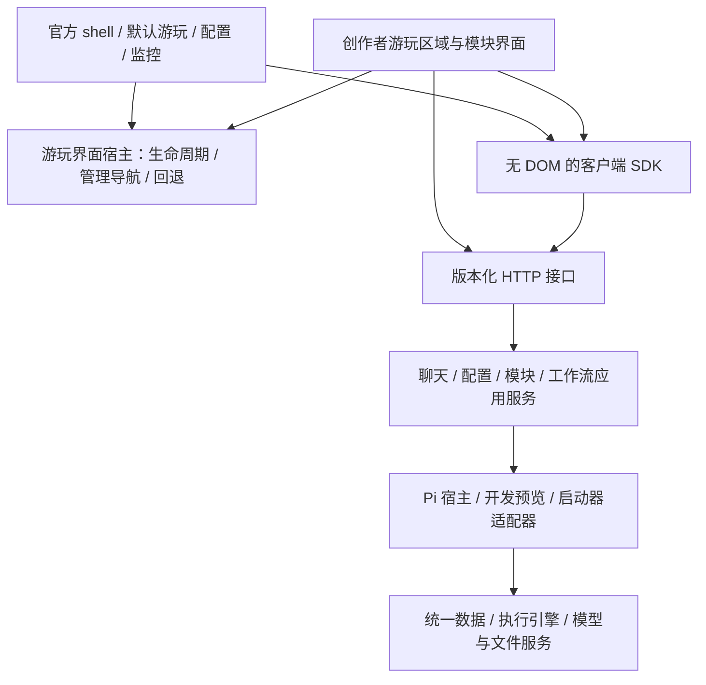

# 前后端分离实施计划

日期：2026-10-14。状态：**S1–S8 已实施；Pi 版本差异按用户要求仅提示，综合验证结果见实施记录**。

本计划响应“让不同功能的前端更容易重构、升级，并允许创作者自由重构前端”。源码基线为当日工作区，HEAD 为 `9cbcab0`，包含已有未提交修改；不能仅以该提交重现盘点结果。事实、路由清单和定位见[源码盘点](.agents/skills/st-card-to-pi-rp/references/frontend-backend-inventory.md)。

本文保留设计决定和验收要求；实际交付及证据见[实施记录](FRONTEND-SEPARATION-IMPLEMENTATION.md)。新增 contract/client/server、游玩宿主及安装工具已实现。历史源码盘点记录的是实施前基线，不代表当前文件布局。

需求补充来源：[用户提供的前端设计讨论](https://chatgpt.com/share/6acef8bd-d9cc-83e8-b1f9-c97f6929ce03)。该讨论没有项目源码，仅用于理解重新设计、不受旧界面限制及多种世界表现形式的需求，不作为源码事实或技术选型依据。用户随后确认 **A：创作者接管整个游玩区域，复用官方管理界面；需要更深定制时，从官方 main 派生分支**。本次按此决定实施；没有创建派生分支，也没有自动更新现有卡或聊天。

## 1. 目标、范围与完成定义

### 1.1 目标

建立稳定的“后端能力—公开协议—客户端—界面”边界。官方界面和创作者界面使用同一公开接口；改变布局、框架、导航或模块呈现，不要求复制 Pi 宿主代码、依赖官方 DOM 或直接读写 session 文件。

官方 main 支持三种定制程度：主题/样式、局部模块界面、整个游玩区域替换。创作者可重新设计正文、输入、场景、模块展示及交互，不必重写配置、诊断等管理功能。整套应用及管理流程的深度定制由从官方 main 派生的分支承担，不作为官方前端包安装机制的承诺。保留本地、一键启动和卡包独立运行方式。开发时允许单独运行前端，发布时允许同一个本地进程托管静态文件。

### 1.2 实施范围

- 根目录公共源码：Web、启动器、开发预览入口、宿主 Web 适配层、打包与校验工具、契约、测试、开发文档及相关 Skill 的接口说明。
- 全局模块源：仅在模块界面声明升级阶段调整声明及对应校验；不改模块故事语义、提示词、数据所有权或工作流业务。
- 新增可复用协议、客户端与 HTTP 层；独立前端示例和合成测试卡。
- 不自动更新 `play/`、已安装启动器、既有卡、用户配置或真实 session；不实施旧卡或会话迁移。后续若需迁移须另立明确任务，本计划不交付旧卡升级流程。
- 不重写 Pi 工作流引擎、统一数据存储或模型执行器；不以本轮工作承诺多用户服务、远程部署或同一 Pi 进程同时执行多个聊天。
- 官方 UI 暂时保留原生 ESM。创作者可以自行构建任意框架的静态产物；玩家运行卡包不需要安装前端构建工具。
- 提供轻量的游玩界面宿主、资源和交互边界；不在本轮引入通用世界引擎、完整动画系统、实时游戏同步或固定的 React/Vue/Canvas/WebGL 技术栈。
- 官方 shell 和管理界面继续由 main 维护；分支可自行修改它们，但自行处理升级冲突及超出公开契约的兼容。通用改进可经后续独立评审回流 main，不为每个分支增加主线特例。

### 1.3 破坏性更新原则

用户明确指定：**本次为破坏性更新，不需要考虑旧卡兼容。** 新架构以新打包卡、新前端及同步更新的官方模块为唯一支持基线，不为旧卡保留旧 API、旧模块前端声明、旧启动/锁格式、自定义 server 或其他运行时兼容层，也不交付旧卡/旧会话迁移工具。

本轮直接更新根源码、官方模块声明、模板、生成器、打包器、校验器及测试夹具；需要变更的协议与包格式明确发布新版本。只为本次架构实际变化升级相应版本，不借此重写无关的数据协议或业务规则。旧响应形状不是验收约束，现有业务功能与权限语义仍须盘点并保留，废弃功能须明确列出。

不兼容版本明确拒绝，不猜测、不静默转换。旧卡、已安装运行时和真实会话仍不自动修改，也不保证它们能与新启动器/新后端混用；需要继续使用旧卡时留在完整旧版本环境，此路径不在新架构验收范围内。新架构内部仍保留 API/宿主版本协商、前端安装失败恢复和受支持版本之间的前端回退；这些机制不等于旧卡兼容。

### 1.4 全局验收条件

1. 不加载官方 HTML/JS、没有 DOM 的客户端能够完成开场、输入、读正文、编辑、预览/采用、工作流观测及模块操作。
2. 启动器、游玩、配置、工作流监控可分别初始化；某个可选面板失败不阻断正文和连接恢复。
3. 两个客户端可各自预览不同正文尝试；正文、模块分页、图片等读取使用一致且显式的版本上下文。
4. 不导入官方 `app.js` 或 `app-context.js` 的独立示例前端，可连接与官方前端相同的新后端完成最小完整流程。
5. 开发配置与卡内配置使用同一套路由契约和客户端；作用域、权限和业务差异由服务实现表达。
6. 官方消费者全部使用新协议；旧 API/视图兼容分支移除，不支持的卡包/声明版本明确拒绝。新协议明确版本、能力和错误，不靠前端猜测内部字段。
7. 在合成卡中仅更换前端产物，后端代码、模块权威数据与模型配置保持不变；打包校验、启动及回退都通过。
8. 项目源码检查、契约行为测试、真实浏览器验收和打包后离线验收分别有证据；缺少某层验证不能标成全部完成。
9. 创作者游玩界面能够占满游玩区域、打开官方管理界面并返回；即使加载失败也能通过宿主控制的入口恢复默认界面。前端替换不覆盖官方管理资产。
10. 提供不包含旧页面源码、CSS、截图或固定布局要求的功能交接包；独立示例用不同布局验证公开契约，业务验收不依赖旧 DOM。

## 2. 盘点结论及优先级

| 编号 | 现状 | 影响 | 处理阶段 |
| --- | --- | --- | --- |
| C01 | `app-context.js` 混合共享 state、DOM、fetch、错误展示 | 复用调用逻辑会连带官方页面 | S2、S5 |
| C02 | `app.js` 集中初始化多个功能并每 600ms 轮询；配置与调用记录另有刷新机制 | 功能入口和生命周期难以独立 | S2、S5 |
| C03 | 开发配置已复用卡内 createApplication，但单独组装 bridge；部分方法缺失或不可用 | 共用路由不等于能力相同，缺方法会落入 500 | S1、S3 |
| C04 | `displayExecutionId` 保存在共享 ActiveBridge，影响正文、模块和生图读取及操作限制 | 多客户端预览互相影响 | S4，必须跨相关桥接层一起完成 |
| C05 | 模块 `region` 同时决定 UI 控件和查询/修改授权 | 自定义布局仍依赖内置区域类型 | S6 |
| C06 | 宿主固定导入卡内 `web/server.mjs`，HTTP handler 固定服务 `public/` | 前端交付与后端启动路径混在一起 | S3、S7 |
| C07 | 启动器 HTML 注入 token，配置页有独立 token 获取与请求逻辑 | 独立客户端缺少明确连接协议 | S1、S2、S3 |
| C08 | API 无统一公开版本、错误码、能力发现及稳定 DTO 层 | 内部重构易传播到创作者代码 | S1、S3 |
| C09 | 头像/封面/图片路径及“系统编辑器打开文件”动作散落 UI | 更换服务地址或宿主时难复用 | S1、S2、S3 |
| C10 | 部分测试固定 app.js import 和共享 elements 结构 | 会把当前耦合误当永久契约 | S2、S5、S8 |
| C11 | 打包以是否存在 `web/server.mjs` 决定是否复制整个 Web；锁文件记录静态哈希，变化只列 changed | 单换前端可能漏装或失去明确的版本/资产清单 | S7 |

已有可复用基础包括 HTTP/JSON 边界、开发/游玩共用路由、分领域 bridge、HostSessionScope、统一数据事务、expectedRevision、部分 operationId、模块声明式视图和前端纯函数。保留这些成果，不从零重建。当前两份路由实现分别是 Web 的 94 种 API 操作和启动器的 3 种操作；开发预览复用前者，不重复计数。

## 3. 设计决定

| 决定 | 本计划采用的方向 | 原因及边界 |
| --- | --- | --- |
| D01 分离程度 | 源码、协议、构建/交付可独立；部署可同进程 | 保留一键本地体验，无需微服务化 |
| D02 前端技术 | 官方原生 ESM；协议及 SDK 与框架无关 | 先解除耦合，框架迁移另行选择 |
| D03 宿主 | Pi 是后端适配器，继续拥有执行生命周期 | 不把“独立前端”扩大成“脱离 Pi 的新引擎” |
| D04 接口 | 统一使用 `/api/v1/`；移除旧 `/api/` 路由实现 | 本次破坏性更新，官方消费者同步切换，不保留双协议 |
| D05 刷新 | 首版以 SDK 统一轮询；预留 transport.watch 接口 | SSE/WebSocket 为后续性能优化，不挡住分离验收 |
| D06 状态 | 权威状态在后端；草稿和浏览选择在客户端；共享偏好显式持久化 | 保留用户选择的持久化范围，不把所有设置搬进 localStorage |
| D07 模块 | 新声明明确能力 binding；默认 renderer 消费 binding | 官方模块源直接更新，定制布局不修改授权，不做旧视图适配 |
| D08 权限 | 公开操作的授权由后端检查；浏览能力不是客户端自报的权限 | SDK 只简化调用；不用页面按钮状态作权限检查 |
| D09 版本 | Web API、游玩宿主、前端包、模块视图版本独立于 Data/Workflow 协议 | 避免只改 UI 就升级全部协议 |
| D10 交付 | 宿主直接接入随包共享 server；前端根目录可选择 | 移除对旧 `web/server.mjs` 入口的依赖，创作者不维护后端文件 |
| D11 定制边界 | main 开放整个游玩区域；官方 shell/管理界面保留 | 改造整套应用走 main 派生分支，不把管理 UI 变成无限插件平台 |
| D12 表现层 | 提供宿主生命周期、资源与受控动作接口 | 渲染方式自由；不另建与现有卡/模块/工作流竞争的世界运行时 |
| D13 重设计依据 | 视觉中立的功能交接包与行为验收 | 可在不看旧 UI 的前提下重新设计；源码盘点另供工程维护使用 |
| D14 发布基线 | 破坏性更新，仅支持新架构卡包 | 删除旧卡兼容负担；版本拒绝、现有数据保护及新包失败恢复仍保留 |

### 3.1 官方与创作者的职责

| 层次 | main 的责任 | 创作者可定制的范围 |
| --- | --- | --- |
| 平台 shell | 连接、卡/聊天交接、管理入口、默认界面恢复、兼容提示 | 请求沉浸布局、打开管理面板、返回游玩；不替换 shell 本身 |
| 官方管理界面 | 模型/Agent/工作流配置、密钥、诊断、运行恢复等既有管理能力 | 从游玩界面调用稳定的导航入口，复用官方功能 |
| 游玩区域 | 提供默认界面与挂载契约 | 整区重做正文、输入、选项、地图、画廊、模块界面、音效及动画；不要求沿用侧栏或聊天气泡 |
| 后端与模块 | 权威数据、动作校验、工作流执行、事务及权限 | 使用公开查询和已声明动作；新增业务按既有模块机制提供 |
| main 派生分支 | 公共 API 与版本兼容说明 | 自行更改 shell、管理流程乃至应用结构；承担相应维护与发布 |

沉浸模式允许隐藏常规导航，但官方管理/退出入口须由宿主保持可达，包括键盘、触屏和创作者界面加载失败的情况。官方面板关闭后返回原游玩上下文；如管理操作切换了聊天或连接，则明确重新绑定，不能恢复过期草稿到其他聊天。具体入口样式不在协议中固定。

“管理/游玩”的拆分首先是职责和交付边界，不是同源脚本的安全隔离。首版为受信任本地内容；不向创作者挂载上下文传递管理密钥，也不声称同源自定义代码无法接触管理能力。未来隔离容器可复用 transport 和宿主导航契约，但须另行实现后端授权与隔离通信。

### 3.2 不依赖旧视觉的功能交接包

S1 建立独立的设计输入：用户目标、前置条件、操作结果、状态变化、冲突/失败/恢复规则、公开 API 和合成数据、行为验收清单。以稳定功能 ID 关联契约及验收，标注属于游玩、官方管理或明确废弃的旧能力；为官方管理功能提供调用入口说明，不要求创作者重复实现。

业务规则、可变的交互习惯、已知缺陷分开记录。例如“采用候选会改变权威版本”是规则，“通过某个下拉菜单采用”是旧界面选择。交接包不带旧源码、样式、截图、控件树；维护者使用的源码盘点与它分开交付。允许全新布局及用户提供的视觉参考，不用像素还原作为功能完成条件。

首版交接包覆盖全部现有功能的归属和关键行为；独立示例仅验证最小完整游玩链路，不据此宣称所有功能无遗漏。后续全量视觉重做需逐项核对功能清单。S1 定义文件位置并纳入发布登记，契约或行为变化时同步更新。

## 4. 目标依赖结构与源码布局

以下是当前维护位置；S1 建立契约源，S3 建立共享 HTTP 层，S7 落实复制关系：

| 维护位置 | 责任 | 禁止依赖 |
| --- | --- | --- |
| `packages/rp-web-contract/` | 领域请求/响应 schema、错误码、能力 ID、版本规则、样例和生成的类型/API 文档 | DOM、Pi、文件系统状态、前端组件 |
| `packages/rp-web-client/` | 可注入 fetch/baseUrl/auth、领域 client、轮询订阅、版本上下文、资源加载 | DOM、官方 UI、Node 专属运行库 |
| `packages/rp-web-server/` | 共享 HTTP 编解码、版本路由、认证适配、静态托管适配 | 官方 HTML、DOM、具体 Pi 全局对象 |
| `assets/pi-rp-web/public/` | 官方 shell、管理面板、游玩界面宿主、默认游玩及模块 renderer、主题；交付时分开登记资产 | Pi 内部对象和权威文件路径 |
| `assets/pi-rp-runtime/.pi/lib/` | 现有 bridge 渐进整理为领域应用服务与 Pi 适配 | 官方页面元素和控件种类 |
| `examples/minimal-rp-frontend/` | 独立客户端例子、运行说明、合成测试接线 | 官方 app.js、app-context.js、隐藏内部接口 |

上表 `assets/` 相对转卡 Skill；`packages/`、`examples/` 相对仓库根。不一次性移动整个宿主，先为现有桥接函数加稳定服务接口，再按领域抽取。类型来自公共契约，不能直接导出带 Pi、绝对目录、密钥或引擎可变对象的 `ActiveBridge`。

浏览器 SDK 与 contract 的可执行部分只用原生 ESM；类型声明供创作者开发使用。若需要校验/文档生成库，仅作为开发依赖并锁定版本；运行时依赖必须随卡包封装。S1 先决定唯一 schema 维护源，类型和接口文档由其生成并检查漂移，不维护三套手写权威定义。

## 5. 公开接口边界

### 5.1 领域覆盖与作用域

| API 领域 | 应提供的能力 | 作用域 / 适配器 |
| --- | --- | --- |
| discovery / connection | API 版本、server instance、模式、card/chat 身份、功能能力、连接交接 | 启动器、开发预览、卡内均提供 |
| launcher | 列卡、封面、最近游玩、启动、返回/交接 | 项目启动器，仍可独立进程 |
| chat / transcript | 开场、历史聊天、恢复、输入、消息/修订、删除后缀 | 当前卡与明确聊天 |
| attempts | 列候选、预览投影、重生成、编辑候选、采用 | 聊天、回合、executionId |
| config | profile 生命周期、导入导出、模型/Agent/工作流/模块参数、密钥设置与受控复制 | 全局或单卡；用户级资料库配置单独标识 |
| workflows / diagnostics | 定义、运行、重执行、重试、恢复、取消、跳过、调用记录、Token 汇总 | 当前聊天；只开放已声明操作 |
| modules | 能力发现、记录/故事/历史、设置/拨档、提醒、已授权工作流 | moduleId + bindingId + readContext |
| images | 配置、连接、运行/恢复/再生成、产物和下载 | 用户/卡配置与聊天产物分别表达 |
| resources / host-actions | 封面、头像、图片、已公开文档内容、前端表现资源；本机编辑器打开动作 | 静态前端资源与会话产物分别表达；受限宿主动作 |

首版不增加通用“任意文件读写”“任意集合查询”“任意工作流执行”接口。配置目录选择本身是受控管理能力，保留其既有路径选择语义；普通内容渲染使用资源 ID/URL，不把绝对文件位置作为客户端算法的一部分。

开发预览明确返回无 card/chat，且缺少聊天执行能力。允许的全局配置由服务提供；以明确模式和 capabilities 取代依赖空数组或旧 `previewMode` 的猜测逻辑。

### 5.2 DTO、错误与长操作

- 查询返回公开 DTO，只含该能力所需数据、稳定 ID、revision、分页/预算标记和 scope；聚合读取可以存在，但不直接透传引擎对象。
- `capabilities` 表示服务支持什么；资源上的 `allowedActions` 和 reason code 表示当前能做什么。两者均不能替代命令执行时校验。
- 新 API 错误统一为结构化 `error`（code、message、可公开 details、retryable）并携带 requestId；HTTP 状态保留。`session_changed`、`revision_conflict`、`unsupported_capability`、`api_incompatible`、`operation_outcome_unknown` 等须与普通验证错误区分。
- 不再靠英文错误字符串识别会话失效；删除旧字符串匹配与相应兼容逻辑。
- 长操作返回操作/run/job 身份和 accepted/状态，不让 UI 通过按钮文案判断完成；只有服务本来支持取消/恢复时才公开相应能力。
- 有副作用的重试使用稳定 operationId；同 ID 不同内容失败。超时后的提交结果未知时先查状态，不换 ID 自动重发。现有未支持幂等的操作不得由 SDK 擅自自动重试。
- 保留统一数据层的 expectedRevision、事务回执和历史语义；显示用的 resourceRevision 不得冒充权威 record revision。

### 5.3 连接、资源与开发方式

首版支持受信任的本地游玩界面包；独立页面用于开发及契约验证。加载同源自定义脚本意味着它拥有该页面获得的 API 能力，不宣称插件沙箱。独立客户端能力继续保留，整套应用的产品集成由派生分支负责。

S1/S3 统一定义 bootstrap/连接契约：返回入口类型、API 范围、serverInstanceId、可用作用域和资源根；凭据获取、刷新、失效及启动器交接由认证适配层负责。保留现有启动器 token 和配置 token 的范围，不能将两者混用，也不能以“方便开发”为由关闭认证。新客户端无需解析 HTML 中的占位符。模型供应商密钥不出现在通用 bootstrap、普通 DTO、日志或导出的前端配置中。

默认静态前端与 API 同源。独立开发使用显式指定后端的本地反向代理，代理覆盖 API 与二进制资源，不假定仅 JSON 请求需要转发；不默认开启任意 Origin 的 CORS。鉴权 bootstrap、来源/Host 校验及不同作用域凭据作为同一连接设计进行行为验证，不能通过把管理 token 放入匿名公共发现接口解决；旧凭据交接方式不设兼容层。

SDK 统一生成资源地址并处理鉴权加载、取消、缓存和释放；UI 不手拼服务 origin。客户端不直接连接模型或 ComfyUI。打开本机编辑器等动作独立于读取文档，按宿主能力启用；不支持的客户端仍可使用后端公开的内容查看能力。

### 5.4 游玩界面宿主与表现资源

游玩宿主只管理前端生命周期，不接管现有卡、模块、工作流或存档。S1 定义独立版本的挂载契约，S5 实现最小宿主；挂载到指定容器，注入已绑定作用域的 client、当前只读上下文、资源解析器及受限宿主导航。导航使用面板 ID/能力发现，不传官方 DOM 或内部函数。管理导航契约与后端管理 API 分开，独立开发示例可以用明确的替身或打开官方管理入口。

生命周期涵盖 mount/unmount、上下文切换、可见性/尺寸变化及连接状态；卸载需取消订阅、请求和动画，停止音频并释放对象 URL 等资源。契约规定异步挂载失败、过期完成和清理顺序；官方 shell 对加载错误提供回退。只承诺处理正常失败和生命周期，不承诺从同源脚本死循环等故障中自动恢复。CSS 作用域约定或 Shadow DOM 可减少样式干扰，但不作为安全沙箱。

前端表现资产与会话生成资产分开登记。首版静态托管和包校验覆盖图片、字体、音频、视频、ESM/CSS 及声明的普通静态文件，明确 MIME、相对路径、子目录/构建分块、版本缓存、缺失回退和路径限制；不默认暴露卡目录中的任意文件。音视频仅提供资产与加载边界，自动播放/用户手势/播放控制由表现层处理；Range、大文件流式优化及 WASM 等特殊运行支持按实际验收能力再声明。

现有 resource catalog 用于创作参考及上下文交付，视觉/音频资产不自动登记为模型上下文。需送给模型的内容仍须按原有模块与工作流声明授权。首版不内置 Pixi/Phaser/Three 等引擎；创作者自行选择并随前端包构建交付。

## 6. 状态归属与多客户端语义

| 状态 | 权威所有者 | 目标处理 |
| --- | --- | --- |
| 聊天文档、正文尝试、采用版本、模块记录 | 后端已有统一数据/执行服务 | 保持事务、revision、来源和回溯规则 |
| 正在执行的回合、工作流、阻塞条件 | 后端运行时 | 只读状态＋明确命令；重连可恢复观察 |
| 当前 Pi 进程激活的聊天 | 后端宿主 | 仍是一份激活聊天；切换是显式共享操作 |
| 某页面预览的正文尝试 | 客户端读上下文 | 不写共享 ActiveBridge；请求明确携带 executionId |
| 草稿、弹窗、选中面板、分页游标、展开折叠、图片缩放 | 客户端实例 | 面板生命周期内维护，必要时本机保存；不污染 session |
| 字号、用户资料、模块排序/隐藏等已保存偏好 | 现有全局/卡级配置 | 保留继承和覆盖规则；编辑草稿与已保存值分离 |
| profile/模型/Agent/工作流配置 | 相应作用域的配置服务 | UI 只维护草稿和提交状态，不复制规范化业务规则 |
| 私有资料库绑定与服务配置 | 既有用户级配置服务 | 在单卡 UI 展示也不改变其用户级作用域 |
| 消息投影、模块摘要、图片缩略图、前端缓存 | 可重建派生层 | 明确失效/重建，不反向成为权威来源 |

### 6.1 请求级版本上下文

读取上下文包含 serverInstanceId、cardId、chatId 和可选 executionId。ID 只用于定位，服务端还要验证归属、可见性、回合边界和读取权限。分页 cursor 必须绑定相同上下文；切换候选/聊天后废弃旧 cursor。

需要一同改造 `rp-web-attempts-bridge.ts`、`activeDataStore()`、`rp-web-modules-bridge.ts`、`rp-image-web-bridge.ts`、相关图片读取以及 workflow 操作中的预览判断。采用状态仍属于后端；预览只返回对应投影，不改变下一次生成的输入。

新 API 的普通写操作仅作用于显式的当前权威聊天；预览投影只读，编辑候选使用专用候选命令。当前在预览时被禁止的操作，在该客户端仍按上下文返回不可执行；另一个查看已采用版本的客户端不应被它连带阻止。失效候选、进入下一回合、删除后续楼层等行为继续遵守既有执行协议。

### 6.2 聊天切换和迟到请求

客户端命令携带预期聊天/连接身份；后端在接收及异步关键写入处复核，继续使用 HostSessionScope 的保护。切换聊天后旧页面发来的新请求也应拒绝或要求重新绑定，不能只防“切换前已经在途”的请求。

SDK 以连接/聊天 generation 丢弃迟到响应，切换时取消旧请求、清空对应缓存和订阅。允许多个页面观察同一激活聊天；本轮不实现一个宿主并行激活多个聊天。

### 6.3 状态刷新

轮询集中在 SDK 的可释放 watcher；按领域按需订阅，防重入、取消、退避、页面隐藏策略均在客户端层。界面订阅不导入定时器实现，卸载时释放。资源缓存键包含 server/chat/readContext，不能只用 URL 或 moduleId。

首版保留合理的刷新频率，不以减少请求为由遗漏后台完成/失败状态。稍后若增加 SSE，应先规定初始快照、重连补偿、事件顺序与丢失后的重同步；不为本轮强制新增事件总线。

### 6.4 权威快照、变化通知与演出播放

SDK 明确区分首次快照、上下文重置、重连同步和已观察到的变化；通知携带 scope/readContext 与相关 revision/稳定身份。轮询可能合并多次变化，首版不承诺完整事件日志或恰好一次投递；需要可靠逐步演出的场景应读取显式持久化记录，不能从刷新次数推断。

打字进度、临时镜头、悬停、粒子及当前音效属于客户端表现状态，不每帧写后端。刷新、预览、重连默认恢复内容，不重复提交业务动作，也不把历史快照当成新奖励/新回合自动重播声音。需要断点续播的剧情进度由对应业务模块明确持久化，不新增任意可写的全局 world state；预览仍只读。

## 7. 模块能力与默认视图拆分

### 7.1 直接采用新声明

S6 直接将官方模块源的前端声明更新为显式 binding：记录查询、故事详情、历史、设置读写、拨档、完整性检查、工作流动作。为新声明定义稳定 bindingId，不要求保留旧 regionId 映射；绑定在后端注册，浏览器不能提交任意 collection/view/capability 来替代它。

binding 保存 collection、record type、命名 view、capability、可编辑字段、参数约束、预算及允许的工作流入口。UI 元数据保存标签、控件、排序和布局。二者可以随同一模块发布，但执行授权不再依赖 renderer 类型。

数据 binding 才需要 collection/view；静态资源或文档 binding 引用已登记资源，不为 resource 模块伪造 collection。模块种类和数据所有权保持不变。

模块前端声明采用 schemaVersion 3，包含 `bindings` 与引用 bindingId 的 `regions`；允许仅提供能力而没有默认区域。模块 manifest 继续指向前端声明文件；仅在自身结构或语义改变时升级 Module 或 Data Contract。JS 和 Python 校验器、模板、模块创建/转卡工具同步以 v3 为支持基线，删除 v1/v2 解析分支，严格检查字段与交叉引用。具体机器 schema 在实施阶段形成并测试，本计划不写入现有 schema。

### 7.2 版本及权限语义

- 官方模块源直接改为 v3，逐项核对原 view、字段、过滤、分页预算和工作流授权；旧卡内的声明不被自动改写，也不由新运行时适配。
- 删除 v1 直接 collections payload 和 v2 region 授权路径。需要保留的展示功能通过新 binding 明确声明，不把全量原始数据作为新公开契约的默认返回；旧声明版本明确拒绝。
- 前端 view 与 Agent 的 rp/maintenance view 保持独立；增加可视化不改变 Agent 可见范围。
- 持久化修改继续走统一变更批次，保留 expectedRevision、幂等、原子性、来源与历史。读取预算由服务端约束。
- 未知可选 renderer 显示可理解的降级；缺少必需能力时明确兼容错误，不静默漏掉关键设置。
- 官方模块面板使用可替换 renderer 注册表；接管游玩区域的创作者可直接通过 binding API 自己绘制。内嵌不受信任第三方脚本隔离不在首版范围。

### 7.3 验证样本

至少覆盖：narrative-controls 的拨档/历史设置、narrative-memory 的记录/提醒/维护、local-scene-narrative 或 world-scope-narrative 的故事目录与全文、comfy-image-generation 的专用画廊与操作。不得只用一个无权限约束的空模块证明通用性。

### 7.4 非表单交互

binding 的动作协议独立于控件，包含模块命名空间、动作 ID、参数/结果约束、目标身份、可用条件及冲突语义。地图选择、卡牌点击、选项按钮和拖拽可调用与默认面板相同的已授权操作；首版以现有模块操作验证这一点，不凭 UI 自由度增加新游戏规则。

后端重新检查权限、上下文、expectedRevision 和已有幂等约束；前端不提交任意处理器路径或工作流名称。新增持久化业务仍通过模块和统一数据变更机制设计，不提供绕过它们的通用 dispatch/save。高频视觉交互留在本地，需要改变业务状态时才调用明确动作。

## 8. 前端交付、兼容和回退

### 8.1 卡包布局

卡内宿主直接从随卡复制的 `runtime/packages/rp-web-server/` 加载 HTTP 实现，相应 contract 一并复制，不能运行时反查仓库根或根 node_modules。同步修改宿主接线、打包必需文件及启动协议声明，取消旧 `web/server.mjs` 的必需性和导入逻辑；不增加薄兼容入口。

新增独立 `web/frontend.json`，记录游玩前端 ID/版本、静态根、挂载入口、所需 Web API 及游玩宿主契约版本、必需/可选 capabilities、资产清单和布局能力。官方 shell/管理资产与可替换游玩资产分开登记，包内路径不得覆盖 shell、管理或后端。默认游玩资产可继续位于 `web/public/` 的明确子目录，创作者产物使用自己的受限目录；具体机器 schema 在 S1/S7 落定。前端 manifest 的版本独立于 `runtime/launch.json`，不开放替换整套应用的安装模式。

SDK 浏览器产物由 `packages/rp-web-client/` 唯一维护源复制或构建到前端 vendor 目录；生成检查验证一致性。启动器与开发配置服务同样获得所需共享包的显式交付，不依赖卡是否安装。

打包器分别处理后端依赖和前端资产，移除“存在 server.mjs 就跳过整个 Web 复制”的隐含关联。只接受新基线输入；旧卡或旧自定义 server 不作为受支持输入，不做自动适配或就地覆盖。官方模板、模块源及合成夹具同步更新，产物生成到新目录。

### 8.2 单独换前端的工作流

S7 提供明确的游玩前端安装/替换工具：输入指定目标卡与前端包，先校验 API/宿主契约兼容性和资产路径，再在临时位置组装、验证并原子切换；保留上一个前端以便回退。默认拒绝覆盖未经确认的同路径自定义文件，使用显式替换参数表达用户意图。官方管理界面和恢复入口随平台交付，不在创作者替换范围内；整套应用更换通过 main 派生分支自行构建发布。

`runtime-lock.json` 目前的哈希差异只列入 `changed`，这一旧行为不约束新设计。S7 明确新锁格式及完整性规则，将可替换游玩资产和受保护的平台/后端资产分别登记；使用明确的新包格式/启动版本标识，让新工具拒绝旧格式，不实现双格式读取。前端替换工具只接收新基线卡包，对本次产物严格校验，只更新指定游玩文件及相应锁条目/元数据，核对官方 shell/管理、后端与模块文件实际哈希未变；失败恢复操作前的前端和 lock。回退目标必须满足当前后端及宿主契约，不承诺跨此次破坏性更新回退。

### 8.3 支持矩阵

| 组合 | 行为 |
| --- | --- |
| 旧卡 + 完整旧版本环境 | 留在旧版本使用，不在新架构支持或验收范围；不自动修改 |
| 旧卡/旧前端 + 新启动器/后端 | 不支持；包版本检查或请求失败明确提示，不提供 legacy 适配 |
| 新前端 + 新后端 | 使用版本化协议、能力发现和请求级上下文 |
| 新前端 + 不满足其 API 的旧后端 | 前端安装时拒绝；运行时报告不兼容，不冒险猜测 |
| v1/v2 模块前端声明 + 新运行时 | 校验时拒绝，不做自动转换 |
| v3 模块前端声明 + 新运行时 | 通过显式 binding 提供能力，按声明使用 renderer |
| 新卡/新声明 + 旧工具 | 不支持；新包标识清楚表达最低要求，不承诺旧工具能正确运行 |
| 自定义游玩区域 + 新后端/官方 shell | 满足 API 与游玩宿主契约；官方 DOM/样式不是兼容条件，管理功能复用官方入口 |
| 深度定制派生分支 + 新后端 | API 仍按公开版本兼容；分支自行维护 shell/管理集成及额外改动，不由主线游玩包工具安装 |

新 API 同一主版本只做向后兼容扩展；删除/语义变更发布新主版本。该规则从新基线建立后生效，不追溯兼容旧卡。前端版本与 API 版本不要求一致，模块/卡/Data/Workflow/launch/lock 版本各自说明用途。本次删除旧协议与格式兼容路径，不要求先提供旧卡升级工具。

## 9. 分阶段实施与交付

| 阶段 | 前置 | 核心交付 | 完成门槛 | 状态 |
| --- | --- | --- | --- | --- |
| S0 盘点及基线 | 本次 | 源码盘点、完整路由列表、状态/交付边界、风险、分阶段计划 | 文档路径和清单核对；明确未做运行验收 | 文档已交付 |
| S1 新契约与行为基线 | S0 | contract 包、DTO/错误/能力、scope/readContext、连接、宿主契约草案、新行为夹具、视觉中立交接包、废弃清单 | 现有功能逐项归属游玩/管理或明确废弃并映射新契约；三种入口字段一致；规则不绑定旧布局/响应 | 已实现；证据见实施记录 |
| S2 无 DOM 客户端 | S1 | SDK、可注入 transport、认证/资源适配、watcher、领域 client；旧页面先替换请求封装 | 无 window/document 可运行；取消/重连/错误/资源/作用域测试；区分快照与变化通知 | 已实现；证据见实施记录 |
| S3 服务与托管分离 | S1；接入用 S2 | 新共享路由、服务接口、能力检查、独立 static host、bootstrap、表现资源托管；移除旧路由 | 卡内/开发配置共用契约测试；API-only 不读官方 public；官方消费者切新协议；资产约束通过 | 已实现；证据见实施记录 |
| S4 状态上下文分离 | S2、S3 | 跨域请求级版本读取、聊天身份保护、删除共享预览状态；独立示例先行验证 | 双客户端预览互不干扰；迟到/跨聊天操作拒绝；示例输入/正文/预览链路通过且恢复不重复提交 | 已实现；证据见实施记录 |
| S5 官方前端模块化 | S2、S3、S4 | shell/管理/游玩边界、最小游玩宿主、独立控制器、局部 state、renderer、生命周期 | 独立示例能挂载；管理打开/返回、上下文变化、沉浸退出、加载失败回退及清理通过 | 已实现；证据见实施记录 |
| S6 模块 binding 协议 | S1、S3、S4；官方接入用 S5 | v3 声明、非表单动作契约、JS/Python 校验；全部官方模块前端声明/模板/夹具更新，删除 v1/v2 分支 | 同能力两种交互；权限/预算/冲突/预览正确；旧声明拒绝；独立示例补入模块交互 | 已实现；证据见实施记录 |
| S7 独立游玩包与交付 | S3、S5、S6 | frontend manifest、API/宿主版本协商、资产清单、安装/回退、共享包复制及锁校验 | 合成卡仅换游玩前端；官方管理/后端/模块不变；缺资产、越界及不兼容拒绝 | 已实现；证据见实施记录 |
| S8 综合验收与创作者文档 | S1–S7 | 扩展先行示例、交接包/指南、浏览器/离线集成、支持矩阵、破坏性发布及分支边界说明 | 满足 §1.4 全部条件，发布/生成/类型检查通过；无旧兼容分支，未验证项明确登记 | 已完成；版本差异仅提示，证据见实施记录 |

### 9.1 每阶段主要文件

- **S1**：新增 contract 包、共享样例及视觉中立交接包；从 `pi-rp-web/server.mjs`、`start-config-ui.mjs`、`pi-rp-launcher/server.mjs` 提取契约。记录宿主导航/生命周期版本及资源语义，避免后续绑定官方组件。阅读 `rp-host-types.ts` 只用于映射内部字段，不把该文件当公开类型。
- **S2**：新增 client 包；替换 `app-context.js`、`config.js`、启动器内联请求及 `app.js` 头像上传；保留 UI 错误展示入口，改为消费结构化错误。纯逻辑可复用 `module-autosave.js`，但不得把其中文 UI 文案变成 SDK 协议。
- **S3**：新增 server 包；提取已有共用的 createApplication，整理 `rp-host-session.ts` 的 startBridge 接线、现有 `rp-web-*-bridge.ts`、开发配置入口和启动器服务。服务差异显式注入，避免在公共 router 内堆 mode 判断。启动时校验服务方法与 capabilities 一致，不支持的调用返回明确错误，不再调用 undefined 方法。static host 支持禁用和指定目录。
- **S4**：`rp-web-attempts-bridge.ts`、`rp-host-session.ts`、`rp-web-modules-bridge.ts`、`rp-image-web-bridge.ts`、`rp-web-workflows-bridge.ts`、`rp-web-chat-bridge.ts`、`rp-host-session-scope.ts` 及客户端缓存。删除旧 `/preview` 写共享 `displayExecutionId` 的路径，所有新读取只使用明确 readContext，不保留第二套预览机制。
- **S5**：`public/app*.js`、`config.js`、`index.html`、默认 renderer 及新增游玩宿主；按 shell/管理/游玩边界移走全局 elements 依赖和集中初始化。优先完成可替换挂载面，默认 UI 保持可用；不对旧 UI 做与分离无关的大规模精修或框架迁移。
- **S6**：`rp-module-frontend.mjs`、`rp-feature-modules.mjs`、`rp-card-content.ts`、`rp-web-modules-bridge.ts`、`validation/frontend.py`、全部官方模块的前端声明、模板/测试夹具、协议与模块创建/转卡说明。代表模块做深入行为验证，其他官方声明也必须全部符合新基线；生成副本只通过维护源工具更新。
- **S7**：`package_card_runtime.mjs`、`install_launcher.mjs`、启动器内唯一 runtime package validator 及 CLI 导入包装、`runtime/launch`/lock 检查、`template-sources.md`、发布清单和白名单、交付测试。同步核对 Node/Pi 最低声明，不因新增工具抬高玩家环境要求而不说明。
- **先行示例与 S8**：`examples/` 从 S2/S3 接口可用后开始，以不同布局覆盖输入/正文/候选预览，S5 接入宿主和官方管理，S6 补模块交互，S8 完成打包后综合验收。同步维护创作者指南、`scripts/verification-suites.mjs`、`runtime-delivery.test.mjs`、验收脚本、README/开发指南/PROJECT_STATUS；公开文档随发布白名单交付。

### 9.2 实施纪律

每阶段用可运行增量验证，受影响官方消费者与新接口配套切换并删除同职责旧实现。实施中允许短暂并存以便验证，但不把临时桥接交付为受支持兼容层；最终产物不得残留仅为旧卡服务的路由、声明解析和启动适配。新架构发布以整套匹配产物为单位，未完成阶段不作为可混用旧卡的升级包发布。

S2 与 S3 可在 S1 契约冻结后分开推进；S4 跨正文/模块/生图，不拆成分别发布的半成品。S5 和 S6 的工作边界按文件和接口分配，最终一起验证 renderer。各阶段不以行数下降作为成功标准。

独立示例是各阶段的接口消费者，不能等全部官方 UI 改完后才开始。首版不要求完整美术设计；示例须实际改变布局、脱离官方游玩代码，并使用合成数据完成关键行为。遇到接口必须依赖旧 DOM 才能完成的功能，先修正边界再继续迁移。

### 9.3 本轮基础与后续工作的划分

| 本轮必须留下并验证的基础 | 后续按需求开展 |
| --- | --- |
| API/SDK、视觉中立交接包、公开能力及版本规则 | 全量视觉重设计、官方框架选型/迁移 |
| 整个游玩区域挂载、管理导航、上下文与清理、恢复入口 | main 派生分支中的整套应用及管理流程重构 |
| 资源路径/MIME/资产清单、构建分块及缺失回退 | 高级音视频、Range 优化、WASM、专门渲染引擎的完整支持 |
| 快照/变化/重同步语义、稳定身份与 revision | 可靠演出日志、复杂演出编排、SSE/WebSocket |
| 声明式动作 binding，既有业务的不同交互形式 | 新游戏规则、实时战斗/物理/多用户同步 |
| 可注入 transport、管理与游玩的职责边界 | 不受信任第三方代码沙箱及细粒度授权体系 |

“预留”必须落实为明确契约、真实消费者和必要验收，不用空占位 API 宣称未来能力已经支持。未知需求保留版本演进空间，不提前设计所有扩展点。

## 10. 验证矩阵

| 层次 | 必须验证的行为 | 主要入口/位置 |
| --- | --- | --- |
| 契约 | 新请求/响应、错误、版本协商、能力缺失、业务功能覆盖；旧端点不再执行操作 | 新 contract 测试、更新后的 backend.test.mjs |
| SDK | 无 DOM、可注入 baseUrl/fetch/auth、二进制、超时、取消、轮询释放、未知提交结果 | 新 client 测试 |
| 服务 | 全局/单卡配置一致，作用域不混写，开发模式不执行聊天 | 共享配置契约测试、rp-web-config-bridge.test.mjs |
| 状态 | 两页不同 preview，正文/模块/图片匹配；切聊天/重连/迟到响应；权威写并发 | attempts/executions、host-session-scope、Web 集成测试 |
| 模块 | v3 的 view/capability/字段/预算拒绝，分页上下文，revision 冲突和回执；拒绝 v1/v2 | rp-module-frontend、rp-data、Python 卡包校验及模块测试 |
| 官方 UI | 未开场/活跃聊天/开发预览；草稿保留、自动保存冲突、挂载/卸载、错误隔离 | frontend-runtime、config-save、module-autosave 测试 |
| 游玩宿主 | 独立挂载、打开/关闭管理、沉浸退出、聊天切换、异步加载失败回退、资源释放 | 宿主契约测试与真实浏览器；恢复入口不依赖创作者代码 |
| 表现资源 | MIME、字体/音视频基本加载、构建分块、相对路径、缺失资源、越界拒绝；不进入模型上下文 | 静态托管/包校验测试；浏览器按声明能力验证 |
| 播放与恢复 | 初始/重连/预览快照不当作新业务事件；变更身份和作用域正确；卸载停止播放 | SDK 通知与示例行为验收，不宣称轮询完整投递 |
| 浏览器 | 原生模块加载、真实 DOM、导航、输入、刷新恢复、图片、独立配置/监控、双页 | 合成卡＋浏览器；记录步骤与结果，不能由 FakeNode 替代 |
| 交付 | 新基线卡在干净目录启动；无仓库根依赖；单换前端及受支持版本回退、锁哈希；拒绝旧包/漏文件/越界路径 | runtime-delivery、test_runtime_package、launcher 测试 |
| 独立实现 | 无官方游玩 DOM/app/context；仅 SDK/公开 HTTP 完成最小链路，再接宿主复用官方管理；不同布局调用模块动作 | minimal-rp-frontend＋合成卡离线验收；完整功能另按交接包追踪 |

现有 `public-dom-contract.test.mjs` 中“模块必须 import 自 app.js”“必须使用共享 elements”的断言属于旧 UI 实现保护，不是开放协议。相关阶段将其改为模块挂载行为、资源可加载和依赖边界测试；不通过删除全部前端测试来完成拆分。

统一检查继续使用 `rtk npm run test:web`、`rtk npm run test:engine`、`rtk npm run test:tools`、`rtk npm run test:python`、`rtk npm run check:generated`、`rtk npm run check:release`、`rtk npm run typecheck`，按改动选择；最后运行 `rtk npm run verify:all`。新 packages/examples 的测试必须注册进发现机制，不能仅独立运行一次。

真实模型/GPU质量不属于分离本身的完成条件；使用离线模型/生图替身验证接线。真实浏览器和实际打包启动属于本计划完成条件。Pi 版本与已验证声明不同时仅提示并继续验证；宿主缺失或实际检查失败时如实记录未通过，不把历史成功次数带入新架构验收。

## 11. 风险与回退边界

| 风险 | 控制方式 | 回退边界 |
| --- | --- | --- |
| 文档描述落后于当前脏工作区 | S1 开始前重跑路由/消费者盘点，保留已知差异 | 不重置用户工作区 |
| 预览迁移只改正文，遗漏模块/图片/操作限制 | S4 双客户端跨域夹具作为切换门槛 | 未通过不发布；回退整组源码变更，不恢复双预览机制 |
| SDK 成为另一个全局页面状态容器 | 无 DOM、实例化 client、独立 watcher、可直接 HTTP 调用 | UI 可替换，契约不依赖 SDK 内部实现 |
| 共用配置 router 时误合并全局/单卡/用户级设置 | 服务 scope 明确，正反例写入隔离目录 | 未通过不切换发布；不引入旧入口兼容层 |
| 拆 region 导致权限扩大/原始数据泄露 | binding 在服务端注册，逐项核对命名 view 和预算 | 修正新声明与实现，旧声明不作为运行回退路径 |
| 自动保存/提交重试覆盖其他客户端修改 | 保存 operationId 与 expectedRevision，冲突保留草稿 | 未知结果查询；不强制覆盖 |
| 独立静态资源只在开发机可加载 | 打包后脱离仓库根测试，资源 origin 由 SDK 管理 | 恢复上一前端及对应 lock |
| UI 需求与当前 API 不匹配 | manifest 预检、必需能力探测、支持矩阵 | 拒绝激活不兼容包 |
| 前端替换误覆盖后端或自定义文件 | 限定替换目录，前后哈希比对，原子切换 | 只回退本次前端和锁条目；不回退 session |
| 创作者接管游玩时误覆盖平台管理 | shell/管理资产单独登记，安装拒绝越界；宿主保留管理/恢复入口 | 回退游玩包；深度定制转由派生分支维护 |
| 前端演出把重连快照误当新事件 | 明确首次/变化/重同步及预览语义；业务写入由明确动作触发 | 重建显示状态，不自动重放副作用 |
| 通用扩展过度设计而拖延分离 | 每个基础接口配真实消费者，复杂引擎与沙箱另立需求 | 保留契约版本机制，不承诺未验收能力 |

## 12. 当前交付

实际实现、验证结果及剩余限制见[实施记录](FRONTEND-SEPARATION-IMPLEMENTATION.md)。创作者入口见[游玩前端指南](FRONTEND-CREATOR-GUIDE.md)，重新设计输入见[视觉中立功能交接](FRONTEND-FUNCTIONAL-HANDOFF.md)。本次是新基线的破坏性更新，旧卡与旧 API 不受支持；现有 `play/`、已安装运行时和真实 session 没有自动修改。
